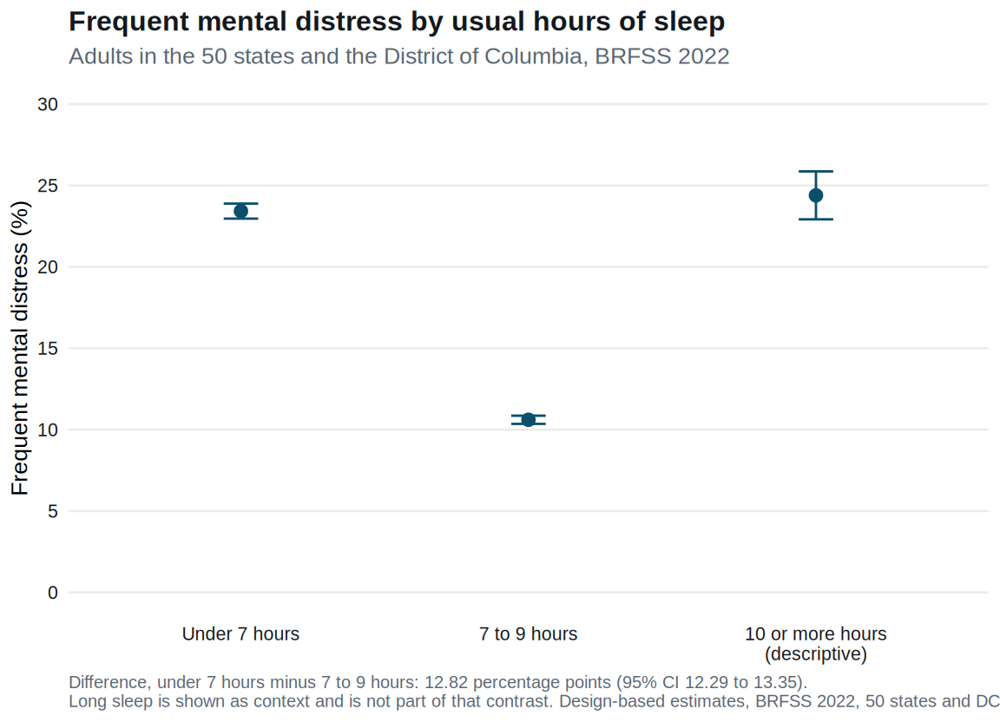

This is independent sample work on a public CDC survey. I wrote the [protocol](protocol.qmd) and the [statistical analysis plan](sap.qmd) before fitting the contrast. A later [amendment note](amendments.qmd) records wording clarifications made after the estimates existed. It does not change the estimands. It is not work I did for an employer, not a product of Nebraska DHHS, and not a regulated submission. It is also not a claims-based study. There is no enrollment window and no diagnosis code.

The question is descriptive. Among adults in the 50 states and the District of Columbia, how much more common is frequent mental distress in people who report a usual sleep of under 7 hours than in people who report 7 to 9 hours? Both answers come from the same telephone interview. The file does not order one before the other.

## The number

In the primary sample, frequent mental distress was 23.43% (95% CI 22.97% to 23.89%) among adults reporting under 7 hours of sleep, and 10.61% (95% CI 10.36% to 10.86%) among adults reporting 7 to 9 hours.

The difference is 12.82 percentage points (95% CI 12.29 to 13.35). The prevalence in the short-sleep group is 2.209 times the prevalence in the 7 to 9 hour group (95% CI 2.141 to 2.277). That ratio is a ratio of the two prevalences. The odds ratio from the age and sex model is a different number, and it is reported further down so the two are not swapped.



Adults reporting 10 to 24 hours, who are not in the contrast, had a descriptive prevalence of 24.39% (95% CI 22.92% to 25.87%). I prespecified that group as context. I did not test it. The pattern on the figure is enough to keep me from reading the primary result as "more sleep, less distress." The long-sleep group is smaller, so its interval is wider, and it sits near the short-sleep group rather than near the 7 to 9 hour group.

Sampling error is not the interesting uncertainty. The confidence interval for the difference is about one percentage point wide. The assumptions are.

## Who is in the estimate

The file is the 2022 combined landline and cell-phone BRFSS public-use file. CDC's landing page says it contains 445,132 records. The download has 445,132 records. After I drop Guam, Puerto Rico, and the US Virgin Islands, 435,826 interviews remain in the 50 states and the District of Columbia. The primary contrast uses 407,452 of those interviews: a valid sleep hour of 1 to 6 or 7 to 9, and an observed mental-health answer.

| Step | Interviews | Sum of weights | Left out |
| --- | ---: | ---: | ---: |
| All records in the 2022 file | 445,132 | 264,789,594 | |
| 50 states and DC | 435,826 | 261,669,771 | 9,306 territorial interviews |
| Valid sleep, 1 to 24 hours | 430,578 | 257,934,506 | 5,248 missing sleep |
| Under 7 hours, or 7 to 9 hours | 415,191 | 248,834,916 | 15,387 long-sleep reports |
| Observed mental-health days | 407,452 | 243,369,067 | 7,739 missing the outcome |
| Age group observed as well | 399,500 | 238,447,438 | 7,952 missing age |

The weight sums are the estimated size of each row's population, not a second analysis. The primary row, 243 million, is the estimated number of adults in the two contrast groups who answered the mental-health item. It is smaller than the 261.7 million represented by all state and DC interviews because missing sleep, long sleep, and missing outcome are outside that row.

Sex was complete in the primary sample. `SEXVAR` is filled for every interview in this file. Age was not. Code 14 on `_AGEG5YR`, the missing-age code, removed 7,952 people from the secondary model, 2.0% of the weighted primary sample.

## What was locked first

Short sleep is `SLEPTIM1` of 1 to 6 hours. The reference is 7 to 9. Long sleep, 10 to 24, is outside the contrast. Codes 77, 99, and blank are missing. I did not impute them.

Frequent mental distress is 14 or more days in the past 30 on which mental health was "not good." Code 88 on `MENTHLTH` is zero days. This is CDC's Healthy Days item, the same cut the calculated variable `_MENT14D` uses. I derived the outcome from `MENTHLTH` and compared every row with `_MENT14D`. There were 0 disagreements among 436,065 people with an observed derived value, and the missingness matched on both sides. The calculated-variable SAS rule and the rule in the plan describe the same people.

Age in the secondary model is `_AGEG5YR`, codes 1 to 13. Sex is `SEXVAR`, codes 1 and 2. I did not fill missing age from `_AGE80`. That variable is imputed, it runs from 18 to 80 with no missing values, and all 9,079 people with age code 14 have an `_AGE80` value. Using it would have invented their age group. I also did not use `_SEX`. It disagrees with `SEXVAR` for 605 people, because the calculated sex variable prefers `BIRTHSEX` when that item was answered. `BIRTHSEX` is not a core item in every state.

## Design

Core questions use `_LLCPWT`, `_STSTR`, and `_PSU` on the combined file. Both of these items are core. `SLEPTIM1` is core section 5. `MENTHLTH` is core section 2. A versioned module file and a module weight would have been the wrong design.

`_PSU` is the annual sequence number. In this file, 17,800 of those numbers appear in more than one stratum, and every stratum-by-PSU cell has one record. The design is nested. Leaving it un-nested is an error the survey package refuses. One hundred ten strata in the state and DC file contain a single PSU, so the package default `survey.lonely.psu = "fail"` stops the variance. I set it to `adjust`, which is the option in CDC's own R example.

That example sets `id = ~1` instead of clustering on `_PSU`. The prose and the SAS example in the same document name `_PSU`. I report the nested `_PSU` design. I also fit `id = ~1`. For this contrast the two standard errors matched in the stored output. That is what I expect when every cluster has one record. It would stop being true if a stratum contained a real cluster of more than one person. The nested specification is the one that survives that check.

The covariance of the two prevalences was estimated with the ratios, not assumed to be zero. At this sample size it is negligible next to the variances. The subset cross-check, which keeps only the 407,452 complete contrast rows and refits the same difference, matched the primary estimate and its standard error. The absolute gap was numerical noise. I still report the full-design ratio. Agreement here is a property of this file, where clusters have size one and the groups are large, not a reason to delete cases first as a habit.

The primary confidence intervals are survey t intervals on the full state and DC design. That design has 435,826 primary sampling units and 2,245 strata, so the degrees of freedom are 433,581. The 0.975 quantile of that t distribution is 1.960, the same as the normal value at the two decimals used here. The age and sex intervals use the secondary design, which has 399,500 sampling units and 2,229 strata, so 397,271 degrees of freedom. That count is stored with the margins. It is large enough that the displayed interval matches a normal interval. It is not 433,581.

The transport file has 328 columns. The landing page says 326, and it labels the zip as 64.3 MB. The object at the official URL on 8 November 2026 was 84,614,105 bytes, SHA-256 `b6319c949b7289f8020fc903c3c2d38fe7e0b28ad703dcd81547f5cd0c0dcfeb`, with a trailing space on the inner member name. The record count and the codebook frequencies for the analysis items match. I treated the page's size and column count as stale labels, and I pinned the hash so a later, different file stops the run.

Weights were finite and positive for every record. They ranged from 0.02 to 54,391. The sum for the states and DC is 261,669,771, which is the raked adult population those weights target. No stratum crossed a state line, so dropping the territorial strata before declaring the design does not mix sampling units.

## Age and sex

The secondary estimate puts both sleep groups on the age and sex distribution of the people who have a contrast sleep group, an observed outcome, and an observed age. The model is a survey logistic regression with main effects of short sleep, five-year age group, and sex. The reported number is the difference in average predicted probabilities, weighted, with both predictions taken over the same people.

That standardized difference is 12.51 percentage points (95% CI 11.98 to 13.03). The standardized prevalences are 23.26% (95% CI 22.81% to 23.72%) and 10.76% (95% CI 10.50% to 11.01%). Age and sex account for a few tenths of a percentage point of the crude gap. They do not account for the gap.

The odds ratio on the short-sleep coefficient is 2.59 (95% CI 2.49 to 2.69). The ratio of the two standardized prevalences is 2.16. The unadjusted prevalence ratio is 2.21. The odds ratio is larger than either, which is what a logistic model does when the outcome is this common. I keep it in the output file so it can be checked. The result I would quote is the difference in percentage points.

The standard error of the standardized difference uses the joint covariance of the two margins, from the survey-logistic coefficients. The age and sex distribution of this sample is the standard population, and it is treated as fixed. The interval therefore does not add a further piece of sampling uncertainty for the chance that another sample would have a different age and sex mix. It is the uncertainty in the predicted prevalences given this standard. Treating the two margins as independent samples would have changed the standard error only in the fourth digit here. The calculation does not rely on that shortcut, and it also does not claim to have accounted for every source of sampling variability in the covariate distribution.

The model assumes a constant log-odds association across age and sex. I did not add interactions after seeing the fit. A different age pattern could exist and still leave the average difference near 12.5 points.

## What else I checked

Missing sleep is 1.4% of the weighted state and DC population (5,248 interviews). Inside the groups that have a valid hour, the mental-health item is missing for 2.4% of the weighted short-sleep group (3,130 of 140,665) and 2.1% of the weighted 7 to 9 hour group (4,609 of 274,526).

The primary analysis drops those missing outcomes. That is the right prevalence if, within a sleep group, people who skipped the item have the same prevalence as people who answered. The file cannot confirm that.

The prespecified bounds refuse that assumption. A missing answer is only constrained to be 0 or 1. The sharp bound for a difference uses opposite assignments in the two groups. The lower endpoint sets every missing short-sleep answer to no distress and every missing 7 to 9 hour answer to distress. The upper endpoint swaps those two assignments. Giving both groups the same fill for the missing answers is a narrower calculation, and it is not the sharp bound.

The lower endpoint is 10.41 percentage points. A sampling 95% confidence interval for that endpoint alone is 9.87 to 10.94. The upper endpoint is 14.88 percentage points, with a sampling interval of 14.35 to 15.42 for that endpoint alone. The identification interval is the span from 10.41 to 14.88. That span is not a confidence interval, and the two sampling intervals are not its ends. The estimated identification interval lies above zero. That says which prevalence differences remain compatible with the observed answers when the missing ones may be anything in {0, 1}. It is not a p-value, and it is not a statement that sleep changes distress. The missing answers are common enough that I would not quote the complete-case difference as if it were known to a tenth of a point.

The bounds do not reassign people who never reported a sleep hour. That would require a guess about their hours.

Dropping usual reports below 3 hours or above 12 hours, which removes 2,636 short reports of 1 or 2 hours from the contrast and a long-sleep tail that was not in the contrast, moves the difference to 12.68 percentage points (95% CI 12.16 to 13.21). Restricting the reference to 7 to 8 hours, and leaving hour 9 out of the contrast rather than calling it long sleep, moves the difference to 13.05 percentage points (95% CI 12.52 to 13.58). The secondary margins move in the same small way: 12.37 points after the extreme-hour exclusion, and 12.71 points with the 7 to 8 hour reference.

The singleton-stratum option changes the standard error and not the point estimate. `adjust` gives 0.269 percentage points. `remove` gives 0.268. `average` gives 0.275. The interval stays about 12.3 to 13.4. Survey 4.5 has no `certainty` option, so I did not invent one.

## If someone has to use the number

I would hand them this paragraph.

In community-dwelling adults in the 50 states and the District of Columbia in the 2022 BRFSS, frequent mental distress is about 23% among people who report under 7 hours of sleep and about 11% among people who report 7 to 9 hours. The gap is 12.82 percentage points (95% CI 12.29 to 13.35). Age and sex, holding this sample's age and sex distribution fixed as the standard, do not explain it. Under the sharp missing-outcome bounds, the estimated identification interval for the same gap runs from 10.41 to 14.88 percentage points. That is a range of values still compatible with the data, not a test and not a causal effect. Extreme sleep reports and a narrower reference band move the complete-case difference by a few tenths of a point.

I would also hand them the limits, in the same paragraph, because the number will be misused if they are attached later. The two answers were given on the same call. The gap is a description of who reports both things. It is not an estimate of what would happen if sleep changed. People in distress may sleep less, short sleep may feed distress, and causes that are not in the model, including pain, work hours, caregiving, and illness, can produce both reports. The 10-or-more-hour group has a similar descriptive prevalence, so a program aimed only at short sleep would be looking at one elevated group and missing another. The outcome is a count of days mental health was "not good." It is not a diagnosis of depression and it is not a case found in medical claims. The estimate does not cover children, people in institutions, or the three territories that fielded BRFSS in 2022.

For a burden description, the gap is large and stable under the checks I prespecified. For a decision to treat sleep as the lever that would close that gap, this file is the wrong instrument.

## Reproduce

From the repository root:

```bash
Rscript studies/brfss-2022-sleep-fmd/run.R
```

The command tests the recodes and the estimators on fabricated samples, verifies the CDC zip, audits the file, and refits the contrasts. Respondent-level data stay in `data/` and are not in the repository. Aggregate tables, the figure, and `estimates.json` are in `studies/brfss-2022-sleep-fmd/output/`. A simulation coverage check is stored beside them and labeled `simulation_not_brfss`. It is not a BRFSS result. In that check, 80 stratified samples from a finite population with a known difference, the interval covered the truth in 78 samples. Eighty replicates is a coarse Monte Carlo check. The sampling uncertainty on a coverage rate near 95% is a few percentage points at that size, so 78 of 80 is compatible with the nominal level and is not a precise calibration. I did not rerun it to chase a rounder fraction.

The run used R 4.3.3, survey 4.5, haven 2.5.5, ggplot2 4.0.3, and jsonlite 2.0.0. The case study page renders with Quarto 1.10.18, the version pinned for the site.

## Sources

Centers for Disease Control and Prevention. 2022 BRFSS survey data and documentation. [https://www.cdc.gov/brfss/annual_data/annual_2022.html](https://www.cdc.gov/brfss/annual_data/annual_2022.html). Last reviewed 2 December 2023. States the file has 445,132 records.

Centers for Disease Control and Prevention. Complex sampling weights and preparing 2022 BRFSS module data for analysis. July 2023. Specifies `_LLCPWT`, `_STSTR`, and `_PSU` for core items, and sets `survey.lonely.psu = "adjust"` in the R example.

Centers for Disease Control and Prevention. Calculated variables in the 2022 BRFSS data file. September 2023. SAS rule for `_MENT14D`, and the definitions of `_AGEG5YR`, `_AGE80`, and `_SEX`.

Centers for Disease Control and Prevention. LLCP 2022 codebook, `USCODE22_LLCP_102523.HTML`, in codebook22_llcp-v2-508.zip. Value labels and unweighted frequencies for `SLEPTIM1`, `MENTHLTH`, `SEXVAR`, `_PSU`, and `_STATE`.

Centers for Disease Control and Prevention. Comparability of data, BRFSS 2022. August 2023. Notes that some states finished 2022 interviews in early 2023. This estimate is an annual cross-section, not a monthly one.

Centers for Disease Control and Prevention. Overview, BRFSS 2022. Weighting by raking to population margins for the combined landline and cell-phone sample.

Lumley T. Analysis of complex survey samples. *Journal of Statistical Software*. 2004;9(8):1-19.

The BRFSS microdata and the CDC documentation are works of the United States government. I am not attaching a new license to those files, and I am not adding a license for the rest of this website.

Lumley T. survey: analysis of complex survey samples. R package version 4.5. License: GPL-2 or GPL-3.

Wickham H, Miller E, Smith D. haven: import and export SPSS, Stata and SAS files. R package version 2.5.5. License: MIT. Includes ReadStat, copyright Evan Miller.

Wickham H. ggplot2: elegant graphics for data analysis. R package version 4.0.3. License: MIT.

Ooms J. jsonlite: a simple and robust JSON parser and generator for R. R package version 2.0.0. License: MIT.
